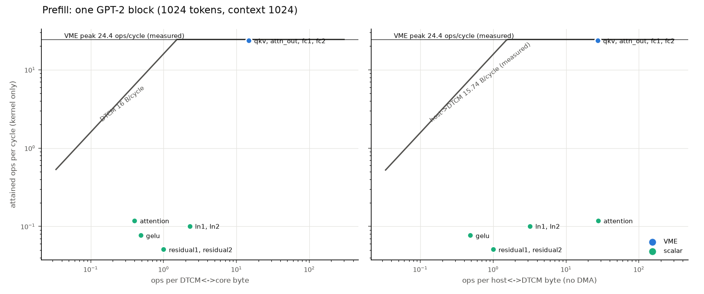
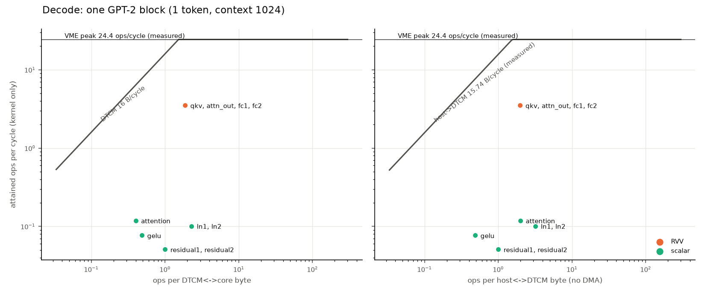

# GPT-2 small int8 on Reef (Coral NPU + VME): week-3 kernel analysis

All cycle counts come from Coral's **VME RTL model** (coralnpu
`VmeCoreMiniAxi`, commit pinned in `config/hardware.json`, Verilator via
cocotb, behavioral SRAM model). Raw numbers: `results/results.json`. Model
numbers: `analysis/roofline.json`. Reproduce with the two commands in the
simulations README. Milliseconds assume the **50 MHz clock, which is not yet
confirmed**. Section 6 lists every number that is assumed rather than
measured.

## 1. What runs, and how well

Every kernel ran on the RTL model and was checked against NumPy:

| Kernel (sim tile) | Cycles | Error vs reference |
| --- | ---: | --- |
| `matmul_vme_s8u8` 16×512×16 | 11,005 | bit-exact |
| `matmul_rvv_s8u8` 16×512×16 | 74,006 | bit-exact |
| `matmul_rvv_s8u8` 1×512×32 (decode) | 9,318 | bit-exact |
| `online_softmax`, 1024-key row | 572,993 | 0.49 LSB (1/255) |
| `gelu`, 4096 elements | 53,287 | 0.49 LSB |
| `layernorm`, 4×768 | 243,069 | 0.50 LSB |
| `residual_add`, 4096 elements | 241,850 | exact |
| `attention_serial` 16q×64k, d=64 | 1,814,058 | 0.90 LSB vs float |
| `attention_flash` 16q×64k | 1,980,632 | 0.50 LSB; within 1 LSB of serial |
| `attention_flash_chunk` 16q × 64-key block | ~2.2M per block | 0.50 LSB; within 1 LSB of serial |

**Microbenchmarks (sim):**

- Scalar load-to-use latency: **5 cycles**.
- Vector `vle32` + `vmv.x.s` chain: **10 cycles**.
- VME: **84 cycles per `matmul_step`** (16×16×4 MACs, including its 8
  operand loads) plus **253 cycles per tile**. That makes the measured peak
  **12.2 MACs/cycle (24.4 ops/cycle)**.
- Host→DTCM over the 128-bit `axi_slave`: **15.7 B/cycle** sustained, with
  the core halted.

**Host embedding** (token + position lookup, int8 out): p95 is **0.37 ms at
1024 tokens** and under 1 µs for decode, well under the 20 ms target. This
was measured on the dev Mac (arm64), not an x86 host.

**Softmax accuracy change.** Moving `attention_serial` from the float
softmax to the uint8 `online_softmax` changed its error against the double
reference from ±0 to ±1 int8 LSB on 4 of the 6 `test_flash` cases.

## 2. Where each operator sits on the roofline

Each figure has two panels. The left panel plots intensity against
DTCM↔core bytes (ceiling: 16 B/cycle). The right panel plots intensity
against host↔DTCM bytes (ceiling: the measured 15.7 B/cycle). Both panels
share the measured VME peak.

| Operator | Engine | Attained ops/cycle | What bounds it |
| --- | --- | ---: | --- |
| qkv, attn_out, fc1, fc2 (prefill) | VME | 23.6–23.8 | **VME issue rate**: at 97% of the measured peak. They sit at about 15 ops/byte, far right of both bandwidth ridges (~1.5 ops/byte), so the 84-cycle step is the limit, not bandwidth. |
| qkv, attn_out, fc1, fc2 (decode) | RVV | 3.5 | **Vector compute**: 1.75 MACs/cycle on a matrix-vector product, at about 1.9 ops/byte. |
| attention | scalar | 0.12 | **Scalar compute**: 2,148 cycles per visible (query, key) pair at d=64. Two `expf` calls and a 64-float accumulator update per key. |
| layernorm, residual, gelu | scalar | 0.05–0.10 | **Scalar float per element**: 79, 59 and 13 cycles per element. |

None of the scalar operators come close to a bandwidth ceiling. The
end-to-end time is a compute problem first.

## 3. End-to-end estimate

The estimate is the sum of measured kernel cycles per tile × the number of
tiles, plus host↔DTCM transfer for every tile at the measured rate. Transfers
are not overlapped with compute: there is no DMA, and the core wins the DTCM
arbiter. Tiling is A-stationary for the matmuls, and attention streams
64-key K/V blocks for 16-query blocks.

| Phase | One block | 12 layers | Attention share | Host-transfer share |
| --- | ---: | ---: | ---: | ---: |
| prefill 16 | 0.37 s | 4.4 s | 23.5% | 3.0% |
| prefill 64 | 2.3 s | 27 s | 50.2% | – |
| prefill 256 | 21.7 s | 261 s | 79.2% | – |
| prefill 1024 | 290 s | 58 min | 93.8% | 0.26% |
| decode (context 1024) | 0.64 s | **7.7 s per token** | 82.8% | 1.7% |

Today, scalar attention is the model. Its cost grows with the
causal-pair count, so it takes over as soon as prefill passes a few dozen
tokens.

## 4. Prefill vs decode

- **Prefill matmuls run on VME at 97% of its measured peak.** On the same
  16×512×16 tile, VME is **6.7× faster than RVV** (11,005 vs 74,006
  cycles).
- **Decode matmuls are matrix-vector (nq = 1), and VME wastes 15 of 16 tile
  rows.** Padded to a VME tile, a 1×512×16 product costs 11,005 cycles for
  8,192 useful MACs: **0.74 useful MACs/cycle, 6% utilization**. RVV does the
  same product in **4,690 cycles (1.75 MACs/cycle), 2.3× faster**. That's why
  `matmul()` sends decode to RVV.
- **Decode is host-transfer heavier.** For matmuls, host cycles are 11.3% of
  kernel cycles in decode versus 5.5% in prefill. Every weight byte crosses
  the host bus once per token, with no reuse across rows.

## 5. Flash vs serial in bytes moved

- **DTCM↔core traffic (derived from the loop structure):** about the same.
  Both read a d-byte K column and a d-byte V row per visible pair, and both
  read and write a d-wide accumulator per pair: float in flash, int32 in
  serial.
  - Serial also writes and reads its score row (int32) and probability row
    (uint8): about 10 extra bytes per pair, roughly 1% more.
  - Flash spends cycles instead: one extra `expf` per key for the rescale.
    It measures **9% slower** than serial on the prefill tile (1.98M vs
    1.81M cycles) and on decode (139,769 vs 128,046).
- **Host↔DTCM traffic is where they differ.**
  - Serial needs one head's whole K and V resident. At n_ctx = 1024 that's
    128 KB, 4× the DTCM, so serial cannot run at full context on this chip.
  - The chunked flash kernel streams K/V instead, at the cost of re-sending
    them for every 16-query block. That's **58.3 MB of host traffic per
    block at prefill 1024**, versus 3.1 MB if K, V, q and out each crossed
    once (19× more).
  - This is negligible today (attention host cycles are 0.03% of attention
    kernel cycles). It becomes the first-order cost once attention compute
    is fast; see 6c.

## 6. Initial architecture suggestions

These are candidates to test, not conclusions. Each comes with the
measurement it rests on and a first-order sensitivity, computed on the
decode and prefill-1024 blocks above.

a. **Hardware exp / softmax support.**
   - **Evidence:** attention is 83–94% of block time. The measured softmax
      costs 560 cycles per element with two `expf` calls each, which puts an
      upper bound of about 280 cycles on one software `expf`. Flash makes two
      `expf` calls per visible pair, so `expf` is up to about 26% of the
      2,148 cycles per pair.
   - **Sensitivity:** a few-cycle exp cuts up to about 26% of attention:
      roughly −22% decode block time and −24% prefill-1024 block time. This
      is an upper bound, because the 280 cycles also include the loop's
      other float work.

b. **A GEMV mode or smaller tile for decode.**
   - **Evidence:** decode matmuls get 1.75 MACs/cycle on RVV. VME pads to
      6% utilization (0.74 useful MACs/cycle).
   - **Sensitivity:** a mode that delivered VME's measured step rate on one
      row (12.2 MACs/cycle) would make decode matmul kernels about 7× faster.
      Matmuls are 14% of the decode block (host transfer included), so that's
      about −11% of decode time today. The share grows once attention is
      accelerated (see the software note below).

c. **Larger DTCM (KV resident) and/or DMA with double buffering.**
   - **Evidence:** streamed attention moves 19× more host bytes than a
      resident KV would (5). Matmul host traffic is 5.5% (prefill) to 11.3%
      (decode) of matmul kernel time, and all of it is serialized today.
   - **Sensitivity today:** small. Host transfer is 0.26% of prefill-1024
      and 1.7% of decode block time, so a DMA that fully hid it saves at most
      that much. A wider host bus has a matching small effect: doubling
      15.7 B/cycle saves ≤0.9% of decode.
   - **When it matters:** once attention runs on VME. For decode, streaming
      K/V costs about 1.0e5 host cycles per block, the same order as
      attention's matmul work at the VME rate (3.15M ops / 23.6 ops/cycle ≈
      1.3e5 cycles). Decode would then be host-bound, and KV residency
      (≥128 KB per head) or DMA overlap becomes the main lever. For
      prefill 1024, the 3.7M host cycles are about 5% of VME-rate attention
      compute.

d. **Separate port per DTCM bank (load VME's A and B in parallel).**
   - **Evidence:** a VME step is 84 cycles for 1,024 MACs, which includes
      four strided A-column loads and four contiguous B-row loads. The VME
      matmuls sit far right of the 16 B/cycle ridge (15 ops/byte, versus a
      ridge at 1.5), so raw DTCM bandwidth isn't the limit. If the 84 cycles
      are mostly serialized load latency, parallel ports would help.
   - **Not yet measured:** how many of the 84 cycles are loads. That needs
      a load-free step microbenchmark (or a pre-transposed A) before this is
      worth pursuing.
   - **Sensitivity:** prefill matmuls are 4.5% of prefill-1024 and 55% of
      prefill-16 block time. Halving the step would save up to about 27% at
      prefill 16, and very little at long context until attention is fixed.

e. **Wider host bus:** see c. Low sensitivity at today's kernel speeds.

**Software note (not hardware, but it changes every sensitivity above):** the
largest lever is moving attention's QKᵀ and P·V onto VME. Every input it
needs now exists: `matmul_vme_s8u8` for scores, uint8 probabilities from
`online_softmax`, and `matmul_vme_u8` for P·V. At the measured 23.6
ops/cycle versus 0.12 for scalar attention, that's about a 200× speedup of
attention's matmul work. After that, softmax exp, decode GEMV utilization
and host streaming become the bottlenecks, so suggestions a–c should be
re-measured.

## 7. Numbers that are assumed, not measured

| Number | Status / source |
| --- | --- |
| Core clock 50 MHz | PD team plan, **unconfirmed**; every ms figure scales with it |
| DTCM 16 B/cycle (`dbus`), 32 KB, 4 contiguous banks | PD team / coralnpu README; not measured in sim |
| AXI slave width 128 bit | RTL (`flags.bzl` `--lsuDataBits=128`) |
| Host→DTCM 15.7 B/cycle | **Measured**, but with the core halted and using the cocotb AXI driver; contention with a running kernel is not measured |
| Host transfers don't overlap compute | Assumption (no DMA; the host only gets cycles the core leaves free) |
| `ebus` latency | Unknown ("tens of cycles"); not used |
| DTCM↔core byte counts | **Derived** from each kernel's loop structure, not measured |
| Full-model cycles | Extrapolated from measured tiles. The VME k-chunk cost uses the measured k-sweep fit; RVV scales linearly in k; attention uses the measured cycles per visible pair (2,148, the same in the prefill and decode streams) |
| Host-side work (summing K-split partial sums, orchestration) | Not counted |
| Quantization scales | Placeholders, not calibrated; affect accuracy numbers, not cycles |
| `expf` cost of about 280 cycles | Upper bound inferred from the softmax measurement |
| Embedding timing | Measured on an arm64 Mac, not the x86 host |
| SRAM timing | Behavioral SRAM model only; no `sram22` macro in coralnpu's flow |
