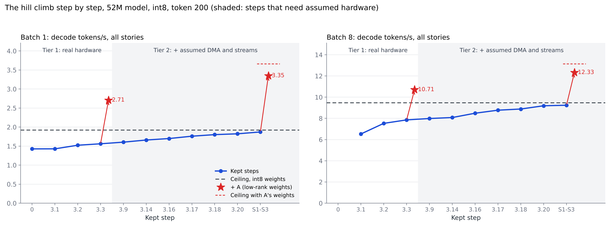
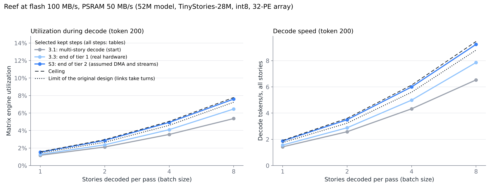
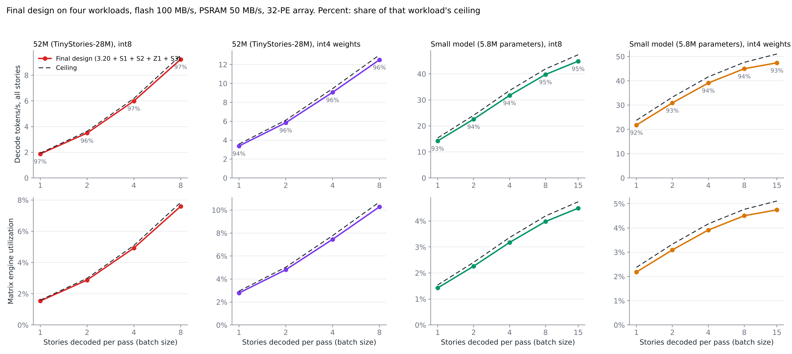

# Reef at 100 MB/s flash and 50 MB/s PSRAM: what each change does

Model names: "52M" is TinyStories-28M (the published name; about 52M parameters with its 50k-word embedding and output layers). "Small" is the 5.8M-parameter model.

> This report does not make decisions. It shows measured data so the reader can decide.

## What was measured

- **Workload:** the 52M model (TinyStories-28M), int8, decode of token 200 with 1, 2, 4 or 8 stories per pass, and time to first token on a 32-token prompt.
- **Fixed:** flash 100 MB/s, PSRAM 50 MB/s, 32-PE Coral matrix array, 32 KB DTCM. Changes are applied one at a time; each is kept only if it gains more than 2% on some metric.
- **The ceiling is computed (not simulated) from the link busy cycles measured in the baseline run:** the flash needs 26.1 M cycles per pass to stream the weights (the same at any batch size), and the PSRAM 2.42 M cycles per story to read and write its KV cache at token 200. **Ceiling** = batch x 50 MHz / (flash + batch x PSRAM - overlap), where overlap = min(qkv flash time, batch x PSRAM) = min(3.17 M, batch x PSRAM): the two links can work at the same time only while the qkv weights stream in, because attention needs its head's q, and attn_out, fc1 and fc2 need attention's output. It counts only overlap the design can do (steps 3.16 to 3.20 do it); a limit that assumed more overlap than the data dependencies allow was dropped from this report as unreachable.
- **Reference, limit of the original design** = batch x 50 MHz / (flash + batch x PSRAM): the two links never work at the same time, which is how the firmware and the single DMA worked up to step 3.15.

## The hill climb in one table

52M model (TinyStories-28M), int8, decode of token 200, flash 100 MB/s, PSRAM 50 MB/s. Tokens/s, all stories. Each kept step adds to the one before. **Tier 1** uses only real hardware: the M3 core with two upstream Coral core changes, and the basic one-channel DMA that the firmware already assumes. **Tier 2** adds assumed hardware (not in the RTL): per-transfer DMA waits, a second DMA channel, and weight and KV streams into the matrix engine (about 12.5 KB of FIFOs). Experiment A (low-rank weights, a firmware and weight-format change, accuracy not checked) is shown on top of each tier.

| Tier | Step | Change | What it is | Batch 1 | Batch 8 |
| --- | --- | --- | --- | ---: | ---: |
| 1 | 0 | Baseline: M3 core, Joshua's firmware | Starting point | 1.43 | n/a |
| 1 | 3.1 | Real multi-story decode | Firmware: one weight pass serves up to 8 stories | 1.43 | 6.53 |
| 1 | 3.2 | 16-entry reorder buffer | Upstream Coral core | 1.52 | 7.53 |
| 1 | 3.3 | Newer load/store unit | Upstream Coral core | 1.56 | 7.86 |
| 1 | + A | Low-rank weights on tier 1 | Firmware and weight format | **2.71** | **10.71** |
| 2 | 3.9 | Per-transfer DMA wait | Assumed DMA feature: start the next weight transfer before waiting | 1.60 | 7.99 |
| 2 | 3.14 | Epilogue one row per token | Firmware | 1.66 | 8.08 |
| 2 | 3.16 | Attention during the qkv weights | Assumed: second DMA channel; firmware reorders qkv by head pair | 1.70 | 8.49 |
| 2 | 3.17 | Weight stream into the matrix engine | Assumed: FIFO in the engine, MACs read weights from it | 1.76 | 8.77 |
| 2 | 3.18 | 4 KB stream transfers | Assumed: 8.3 KB weight FIFO | 1.80 | 8.88 |
| 2 | 3.20 | KV stream into the matrix engine | Assumed: 4.2 KB KV FIFO | 1.82 | 9.19 |
| 2 | S1-S3 | Cross-size firmware steps S1, S2, S3 | Firmware: head-ready fix, layer norm per token, next weights early (with the code-space pass) | 1.87 | 9.24 |
| 2 | + A | Low-rank weights on tier 2 | Firmware and weight format | **3.35** | **12.33** |
| | | Ceiling, int8 weights (from the link times) | | 1.92 | 9.46 |
| | | Ceiling with A's weights (half the flash bytes) | | 3.66 | 13.14 |

The tier-2 firmware steps (3.14, S1 to S3) were measured on tier 2 only; some would also help tier 1, so tier 1 is a conservative figure. The ceiling is for int8 weights; A and int4 lower the bytes and so raise their own ceiling.

### What each kept step changed

| Step | Kind | What changed |
| --- | --- | --- |
| 3.1 | Firmware | One weight pass serves up to 8 stories: each story gets its own KV cache, position, attention call and next-token pick |
| 3.2 | Core (upstream Coral) | Reorder buffer 8 to 16 entries |
| 3.3 | Core (upstream Coral) | Newer load/store unit: overhead per instruction instead of per vector register |
| 3.9 | Assumed DMA + firmware | The DMA numbers its transfers and can wait for all but the newest, so the next weight chunk starts before the current one is waited for |
| 3.14 | Firmware | Linear epilogue reads one accumulator row per token (16 features) instead of one column per feature |
| 3.16 | Assumed DMA + firmware | A second DMA channel (flash and PSRAM at the same time) and a wait for one numbered transfer; qkv computed one head pair at a time so attention runs between qkv weight chunks |
| 3.17 | Assumed hardware + firmware | Weights go from the DMA into a FIFO in the matrix engine; MACs take their weight operand from it, so the MAC loop loads only activations |
| 3.18 | Assumed hardware | 4 KB stream transfers instead of 2 KB (weight FIFO 8.3 KB) |
| 3.20 | Assumed hardware + firmware | KV cache streamed into the matrix engine the same way (KV FIFO 4.2 KB) |
| S1 | Firmware (bug fix) | Attention starts each head as soon as its q, k, v exist, for any head size (was right only for the 52M model) |
| S2 | Firmware | Layer norm per token, 16 features per vector (made room in ITCM by removing dead one-token attention code) |
| Z1 | Build | Code-size pass: shared function entry/exit code, DMA helper not inlined (frees 976 B of ITCM, no speed change) |
| S3 | Firmware | The next linear's first weight chunks start during the current linear's last ones |

### Firmware changes by kernel (Joshua's firmware, 83f7152, to the final design)

| Kernel | Used for | Changes |
| --- | --- | --- |
| `main.cc` | The decode loop | Multi-story decode (3.1); qkv by head pair with attention in between, attention output written over q (3.16); next-linear hints (S3) |
| `linear.cc` | qkv, attn_out, fc1, fc2, lm_head | Argmax per story (3.1); next chunk before the wait (3.9); epilogue by row (3.14); waits for its own transfer, column-group ranges, attention hook (3.16); MAC loop without weight loads, bias by DMA (3.17); 4 KB chunks (3.18); next linear's chunks early (S3); DMA helper as one function (Z1) |
| `attention.cc` | Attention | Per-story KV cache (3.1); step-wise decode attention paced between weight chunks, 176 B decode state (3.16); KV MACs from the stream, new-token block through the DTCM (3.20); head-ready count (S1); dead one-token code removed (S2) |
| `layernorm.cc` | ln1, ln2, ln_f | Per token, 16 features per vector (S2) |
| `lm_head.cc`, `embed.cc` | Output, input | Next-token pick per story, all stories at one position (3.1) |
| `npu.hpp`, `common.hpp` | Helpers, DTCM layout | Numbered DMA transfers and waits (3.9, 3.16); stream MAC loops (3.17, 3.20); decode attention state in the DTCM (3.16) |

Rejected and dropped steps (3.4 to 3.8, 3.10 to 3.13, 3.15, 3.19, S4, S5) are in the full table below and in LOG.md.

## How the ceilings are calculated

A formula, not a simulation. The inputs are measured from runs; nothing else is assumed.

1. **Flash cycles per pass (F):** the flash link's busy cycles in one decode pass, from the run's counters. It covers the weight bytes (51.3 MB at int8, about 2 bytes a cycle at 100 MB/s) plus each transfer's first-byte latency. It is the same at every batch size, because one weight pass serves every story in it.
2. **PSRAM cycles per story (P):** the PSRAM link's busy cycles in one pass divided by the batch size. It covers one story's KV cache read and write at token 200 (about 1.84 MB at 50 MB/s) plus burst overhead.
3. **qkv window (Q):** the flash cycles of the qkv weights alone, layers x 3 x (hidden / 64) x (hidden x row bytes + 256) / 2, with row bytes 64 at int8 and 32 at int4. This is the only time the PSRAM can work while the flash works, because attention needs q, and attn_out, fc1 and fc2 need attention's output.
4. **Shortest possible pass (T):** F + batch x P - min(Q, batch x P): the two links' times added, less the part of the PSRAM time that fits inside the qkv window.
5. **Ceiling, tokens/s** = batch x 50 MHz / T. **Ceiling, matrix utilization** = MACs per pass / (T x 128), with 128 the MACs a cycle of 32 PEs. The two show the same thing in different units.
6. **Time to first token:** the prefill's flash cycles / 50 MHz (its PSRAM time fits inside the qkv windows).

For the 28M int8 results below, F = 26.1 M, P = 2.42 M and Q = 3.17 M cycles, from the baseline run. The Phase 6 workloads use each build's own runs. Measured busy cycles are used instead of byte counts so that per-transfer latency and burst overhead, which the links really spend, are inside the ceiling.

## Results

Decode is total tokens/s across all stories; the percentage is the share of the ceiling reached.

| Step | Change | Kind | Kept | Batch 1 | Batch 2 | Batch 4 | Batch 8 | Time to first token |
| --- | --- | --- | --- | ---: | ---: | ---: | ---: | ---: |
| | **Ceiling** | | | 1.92 | 3.60 | 6.14 | 9.46 | 1.30 s |
| | If about 1.6 MB of on-chip SRAM held prefetched KV (not in the design; not simulated) | | | 1.92 | 3.83 | 7.67 | 15.33 | |
| | Reference: limit of the original design (links take turns) | | | 1.75 | 3.23 | 5.59 | 8.80 | 1.33 s |
| 0 | Baseline: M3 core, Joshua's firmware |  | yes | 1.43 (74%) | n/a | n/a | n/a | 2.01 s (64%) |
| 3.1 | Real multi-story decode | Firmware | yes | 1.43 (75%) | 2.58 (72%) | 4.33 (71%) | 6.53 (69%) | 2.01 s (64%) |
| 3.2 | 16-entry ROB | Upstream Coral hardware | yes | 1.52 (79%) | 2.80 (78%) | 4.82 (78%) | 7.53 (80%) | 1.67 s (78%) |
| 3.3 | Newer LSU (LsuV3) | Upstream Coral hardware | yes | 1.56 (81%) | 2.88 (80%) | 4.99 (81%) | 7.86 (83%) | 1.60 s (81%) |
| 3.5 | One pointer per row, running counters | Firmware | no | 1.57 (82%) | 2.90 (81%) | 5.02 (82%) | 7.90 (84%) | 1.59 s (82%) |
| 3.5b | Alternate register sets for weight loads | Firmware | no | 1.56 (81%) | 2.88 (80%) | 4.99 (81%) | 7.86 (83%) | 1.60 s (81%) |
| 3.6 | Two-pass decode attention | Firmware | no | 1.56 (81%) | 2.88 (80%) | 4.98 (81%) | 7.84 (83%) | 1.60 s (81%) |
| 3.4 | Segment-load weight layout | Firmware and flash layout | no | 1.57 (82%) | 2.90 (80%) | 5.02 (82%) | 7.91 (84%) | 1.59 s (82%) |
| 3.7 | Start the next linear's first weight chunk early | Firmware | no | 1.56 (81%) | 2.89 (80%) | 5.00 (81%) | 7.87 (83%) | 1.60 s (81%) |
| 3.9 | Per-transfer DMA wait (ASSUMED hw) | Assumed hardware + firmware | yes | 1.60 (84%) | 2.95 (82%) | 5.10 (83%) | 7.99 (84%) | 1.56 s (83%) |
| 3.8 | Second DMA channel, one per link (ASSUMED hardware) | Assumed hardware + firmware | no | 1.60 (84%) | 2.96 (82%) | 5.10 (83%) | 8.00 (85%) | 1.56 s (83%) |
| 3.14 | Epilogue by tile row (round 2, r2) | Firmware | yes | 1.66 (87%) | 3.05 (85%) | 5.22 (85%) | 8.08 (85%) | 1.53 s (85%) |
| 3.10 | Write back only the new V row | Firmware | no | 1.61 (84%) | 2.97 (82%) | 5.13 (84%) | 8.08 (85%) | 1.56 s (83%) |
| 3.11 | Copy the bias out, start chunk i+2 before the epilogue | Firmware | no | 1.66 (87%) | 3.06 (85%) | 5.26 (86%) | 8.12 (86%) | 1.51 s (86%) |
| 3.12 | Layer norm per token (earlier round 2, r5) | Firmware | no | 1.69 (88%) | 3.10 (86%) | 5.27 (86%) | 8.11 (86%) | 1.51 s (86%) |
| 3.13 | A rows load only the token lanes (earlier round 3) | Firmware | no | 1.66 (87%) | 3.05 (85%) | 5.21 (85%) | 8.07 (85%) | 1.53 s (85%) |
| 3.15 | DMA setup overlapped with the previous transfer (ASSUMED hardware) | Assumed hardware | no | 1.69 (88%) | 3.10 (86%) | 5.29 (86%) | 8.18 (86%) | 1.50 s (86%) |
| (data) | 3.10 + 3.11 + 3.12 + 3.15 together, each rejected alone (not a step) | Firmware + assumed hardware | data only | 1.72 (90%) | 3.17 (88%) | 5.42 (88%) | 8.34 (88%) | 1.48 s (88%) |
| 3.16 | Attention during the qkv weights (ASSUMED 2-ch DMA) | Assumed hardware + firmware | yes | 1.70 (89%) | 3.20 (89%) | 5.53 (90%) | 8.49 (90%) | 1.52 s (85%) |
| 3.17 | Weight stream into the engine (ASSUMED hw) | Assumed hardware + firmware | yes | 1.76 (92%) | 3.29 (91%) | 5.66 (92%) | 8.77 (93%) | 1.46 s (89%) |
| 3.12r | Layer norm per token, retry on 3.17 | Firmware | no | 1.79 (94%) | 3.34 (93%) | 5.72 (93%) | 8.80 (93%) | 1.44 s (90%) |
| 3.15r | DMA setup overlap, retry on 3.17 (ASSUMED hw) | Assumed hardware | no | 1.79 (94%) | 3.35 (93%) | 5.75 (94%) | 8.90 (94%) | 1.43 s (91%) |
| 3.19 | Every-PE array mapping (ASSUMED hw) | Assumed hardware | no | 1.76 (92%) | 3.29 (91%) | 5.66 (92%) | 8.78 (93%) | 1.46 s (89%) |
| 3.7r | Next linear's chunks early, retry on 3.17 | Firmware | no | 1.77 (92%) | 3.31 (92%) | 5.68 (93%) | 8.80 (93%) | 1.46 s (89%) |
| 3.18 | 4 KB stream transfers (ASSUMED 8.3 KB FIFO) | Assumed hardware + firmware | yes | 1.80 (94%) | 3.35 (93%) | 5.75 (94%) | 8.88 (94%) | 1.42 s (91%) |
| 3.18 (attempt 2) | 8 KB stream transfers (ASSUMED 16.4 KB FIFO); under 2% over attempt 1 | Assumed hardware + firmware | no | 1.81 (94%) | 3.38 (94%) | 5.76 (94%) | 8.86 (94%) | 1.41 s (92%) |
| (data 2) | 3.12 + 3.15 on 3.18 together (not a step) | Firmware + assumed hardware | data only | 1.85 (97%) | 3.44 (95%) | 5.87 (96%) | 9.00 (95%) | 1.40 s (93%) |
| 3.20 | KV cache streamed into the engine (ASSUMED 4.2 KB FIFO) | Assumed hardware + firmware | yes | 1.82 (95%) | 3.43 (95%) | 5.91 (96%) | 9.19 (97%) | 1.43 s (91%) |
| S1 | Head-ready fix for any head size (cross-size step; 0% here, +4.4% small b1) | Firmware (bug fix) | yes | 1.82 (95%) | 3.43 (95%) | 5.91 (96%) | 9.19 (97%) | 1.43 s (91%) |
| S2 | Layer norm per token + ITCM trims (cross-size; +8.6% small int4 b1) | Firmware | yes | 1.85 (97%) | 3.49 (97%) | 5.98 (97%) | 9.22 (97%) | 1.42 s (91%) |
| S4 | Bias-only weight buffers, small model batch 16 (cross-size) | DTCM layout | no | 1.86 (97%) | 3.49 (97%) | 5.98 (97%) | 9.22 (97%) | 1.41 s (92%) |
| Z1 | Code-space pass: -msave-restore, dma() not inlined (frees 976 B of ITCM) | Build / firmware | data only | 1.85 (97%) | 3.48 (97%) | 5.97 (97%) | 9.22 (97%) | 1.42 s (91%) |
| S3 | Next linear's weights early (cross-size; +2.6% small b1) | Firmware | yes | 1.87 (98%) | 3.50 (97%) | 5.99 (98%) | 9.24 (98%) | 1.41 s (92%) |
| S5 | Bigger, deeper KV steps (needs a 12.3 KB KV FIFO, was 4.2 KB); dropped for the FIFO cost | Firmware + assumed FIFO size | no | 1.86 (97%) | 3.54 (98%) | 6.02 (98%) | 9.29 (98%) | 1.41 s (92%) |

Matrix engine utilization (MACs done / MACs the 32-PE array can do):

| Step | Batch 1 | Batch 2 | Batch 4 | Batch 8 | Prefill |
| --- | ---: | ---: | ---: | ---: | ---: |
| Ceiling | 1.58% | 2.96% | 5.05% | 7.78% | 10.1% |
| Reference: original design | 1.44% | 2.66% | 4.60% | 7.24% | 9.8% |
| 0 | 1.17% | n/a | n/a | n/a | 6.5% |
| 3.1 | 1.17% | 2.12% | 3.56% | 5.37% | 6.5% |
| 3.2 | 1.25% | 2.30% | 3.96% | 6.19% | 7.8% |
| 3.3 | 1.28% | 2.37% | 4.10% | 6.46% | 8.2% |
| 3.9 | 1.32% | 2.43% | 4.19% | 6.57% | 8.4% |
| 3.14 | 1.36% | 2.51% | 4.29% | 6.64% | 8.6% |
| 3.16 | 1.40% | 2.64% | 4.55% | 6.98% | 8.6% |
| 3.17 | 1.45% | 2.71% | 4.66% | 7.21% | 9.0% |
| 3.18 | 1.48% | 2.76% | 4.73% | 7.30% | 9.2% |
| 3.20 | 1.50% | 2.82% | 4.86% | 7.56% | 9.2% |
| S1 | 1.50% | 2.82% | 4.86% | 7.56% | 9.2% |
| S2 | 1.52% | 2.87% | 4.91% | 7.58% | 9.2% |
| S3 | 1.54% | 2.88% | 4.93% | 7.60% | 9.3% |

## What the data shows so far

- **With the last kept steps (3.20, then the cross-size steps S1 and S2), decode reaches 96 to 97% of the ceiling at every batch size** (1.85 tokens/s at batch 1, 9.22 total at batch 8; time to first token 1.419 s). The ceiling counts only the overlap the data dependencies allow: attention can start once its head's q exists, but attn_out, fc1 and fc2 need attention's output, and lm_head's weights (half of all weight bytes) come after the last layer.
- **Steps 3.9, 3.16, 3.17, 3.18 and 3.20 depend on hardware that is assumed, not in the RTL** (the DMA itself is not in M3): a per-transfer wait, a second DMA channel with its own waits, a weight stream from the flash into the matrix engine (FIFO 8.3 KB, measured as the most it held) and a KV stream from the PSRAM (FIFO 4.2 KB).
- **Batch 1 is now within 4% of its ceiling, and that ceiling (1.92 tokens/s) is the flash reading 51 MB of int8 weights per token.** Only fewer bytes per token raise it (int4, a smaller vocabulary or model), which are the planned int4 and small-model experiments. The every-PE array mapping (3.19) changes nothing at these link speeds: the array is busy 3 to 14% of the pass.
- **Seven other changes made no measurable difference** (3.5, 3.5b, 3.6, 3.4, 3.7, 3.13, 3.19), and seven more gained under 2% each (3.8, 3.10, 3.11, 3.12 twice, 3.15 twice, 3.7 retry). Each removed the stall it targeted, but the time moved to waiting on the flash or the PSRAM.

Diagnostic and check runs (not steps): DMA setup set to 0 on step 3.9 (runs/d9_nosetup, -1.7% of the b1 token) and flash first-byte latency set to 0 (runs/d9_nolat, -1.4%), which located the per-transfer cost; step 3.16 with one DMA channel (runs/d316_1ch: same cycles as 3.14, so 3.16's gain is the overlap); every-PE mapping (step 3.19). Each new simulator build was first checked to run the previous kept step's programs to the same cycle (runs/v4_* to v10_b1).

## Phase 6: other workloads on the final design

Each row is the final firmware and hardware (step 3.20 plus the cross-size steps S1, S2, Z1 and S3 below) with the workload changed. The ceiling is the dependency-aware one, computed from that build's own measured link busy cycles. int4 assumes the weight stream unpacks int4 to int8 at no cost; the KV cache stays int8. Max batch is the most stories per pass that fit the 32 KB DTCM (15 for the small model; 8 for 52M). Before S1 and S2 (step 3.20 as is), the small model reached 81 to 82% of its ceiling at batch 1; the cross-size hill climb below raised it to 92 to 93%.

| Workload | Batch | Tokens/s, all stories | Each story | Share of ceiling | Matrix utilization | Flash busy | PSRAM busy |

| --- | ---: | ---: | ---: | ---: | ---: | ---: | ---: |
| 52M (TinyStories-28M), int8 | 1 | 1.87 | 1.87 | 97% | 1.54% | 97% | 9% |
| 52M (TinyStories-28M), int8 | 2 | 3.50 | 1.75 | 96% | 2.88% | 91% | 17% |
| 52M (TinyStories-28M), int8 | 4 | 5.99 | 1.50 | 97% | 4.93% | 78% | 29% |
| 52M (TinyStories-28M), int8 | 8 | 9.24 | 1.16 | 97% | 7.60% | 60% | 44% |
| 52M, int4 weights | 1 | 3.38 | 3.38 | 94% | 2.78% | 89% | 16% |
| 52M, int4 weights | 2 | 5.85 | 2.92 | 96% | 4.81% | 77% | 28% |
| 52M, int4 weights | 4 | 9.06 | 2.27 | 96% | 7.45% | 60% | 43% |
| 52M, int4 weights | 8 | 12.50 | 1.56 | 96% | 10.28% | 41% | 60% |
| Small (5.8M), int8 | 1 | 14.23 | 14.23 | 93% | 1.42% | 84% | 26% |
| Small (5.8M), int8 | 2 | 22.58 | 11.29 | 94% | 2.26% | 67% | 41% |
| Small (5.8M), int8 | 4 | 31.72 | 7.93 | 94% | 3.18% | 47% | 57% |
| Small (5.8M), int8 | 8 | 39.76 | 4.97 | 95% | 3.98% | 29% | 71% |
| Small (5.8M), int8 | 15 | 44.87 | 2.99 | 95% | 4.49% | 18% | 81% |
| Small (5.8M), int4 weights | 1 | 21.78 | 21.78 | 92% | 2.18% | 66% | 39% |
| Small (5.8M), int4 weights | 2 | 30.90 | 15.45 | 93% | 3.09% | 47% | 56% |
| Small (5.8M), int4 weights | 4 | 39.10 | 9.78 | 94% | 3.91% | 30% | 70% |
| Small (5.8M), int4 weights | 8 | 44.98 | 5.62 | 94% | 4.50% | 17% | 81% |
| Small (5.8M), int4 weights | 15 | 47.40 | 3.16 | 93% | 4.74% | 10% | 85% |

Time to first token, 32-token prompt: 52M (TinyStories-28M), int8 1.414 s; 52M, int4 weights 0.790 s; Small (5.8M), int8 0.263 s; Small (5.8M), int4 weights 0.167 s.

Cross-size hill climb (each step written for both sizes, measured on all four workloads, kept if it gains more than 2% on any):

| Step | Change | 52M int8 | 52M int4 | Small int8 | Small int4 | Result |
| --- | --- | --- | --- | --- | --- | --- |
| S1 | Bug fix from step 3.16: mark 64 / head size heads ready per finished qkv group (it marked 2, right only for 52M) | 0.0% | 0.0% | +4.4% b1 | +3.8% b1 | Kept |
| S2 | Layer norm per token (step 3.12), with ITCM room made by removing dead one-token attention code | +1.7% b1 | +3.1% b1 | +5.8% b1, -0.9% b15 | +8.6% b1, -1.0% b15 | Kept |
| S3 | Next linear's weights early (step 3.7 retry) | | | | | Not run: about 270 B more code than the 8 KB ITCM has free |
| S4 | Bias-only DTCM weight buffers, so the small model fits batch 16 | +0.2% | +0.4% | b16 +0.9% over b15 | b16 +0.4% over b15 | Rejected: PSRAM-bound at large batch |
| Z1 | Code-space pass (see below): frees 976 B of ITCM | -0.1% | -0.1% | +0.2% | +0.6% | Adopted as the base: no measurable cost, makes room for S3 |
| S3 | Next linear's weights early, after the code-space pass made room | +1.0% b1 | +1.5% b1 | +2.6% b1 | +0.4% b1, TTFT +1.3% | Kept |
| S5 | Decode attention: twice the KV blocks per transfer, three steps in flight | -0.4% b1, +0.5% b8 | +1.8% b1 | +2.5% b1 | +2.7% b1, +0.4% b15 | Dropped: the KV FIFO would grow from 4.2 to 12.3 KB for 2 to 3% at small b1 |

What limits each workload now: every one is at 90 to 97% of its ceiling. The small model is lowest at batch 1, where fixed costs per pass matter most; from batch 4 up it waits on the PSRAM. After the code-space pass and S3 the 52M prefill image uses 7,496 of 8,192 B of ITCM (696 B free).

PSRAM burst length (a part or mode with longer bursts; config only, `ext_ram_max_burst_bytes`; today 93 B), on step 3.20. Decode tokens/s:

| Workload | Batch | 93 B | 186 B | 372 B | No limit |
| --- | ---: | ---: | ---: | ---: | ---: |
| 52M, int8 | 1 | 1.82 | 1.83 (+0.2%) | 1.83 (+0.3%) | 1.83 (+0.3%) |
| 52M, int8 | 2 | 3.43 | 3.48 (+1.6%) | 3.51 (+2.4%) | 3.54 (+3.1%) |
| 52M, int8 | 4 | 5.91 | 6.10 (+3.2%) | 6.20 (+4.9%) | 6.29 (+6.4%) |
| 52M, int8 | 8 | 9.19 | 9.67 (+5.2%) | 9.94 (+8.1%) | 10.18 (+10.8%) |
| 52M, int4 | 1 | 3.23 | 3.28 (+1.5%) | 3.31 (+2.3%) | 3.32 (+2.7%) |
| 52M, int4 | 2 | 5.67 | 5.83 (+2.9%) | 5.92 (+4.5%) | 6.00 (+5.9%) |
| 52M, int4 | 4 | 8.89 | 9.33 (+5.0%) | 9.58 (+7.8%) | 9.81 (+10.3%) |
| 52M, int4 | 8 | 12.41 | 13.30 (+7.2%) | 13.81 (+11.3%) | 14.28 (+15.1%) |

## Code space (ITCM) pass

The 8 KB ITCM must hold the prefill and decode code in one image. The build already optimized for size and dropped unused functions. Two more changes free 976 B in the 52M prefill image (8,184 to 7,208 B): `-msave-restore` (shared function entry and exit code, -440 B) and dma() as one function instead of inlined at every call (-388 B). Measured on all four workloads (step Z1): -0.1% to +0.6%, so no measurable cost. Used as the base for experiments A and B and step S3.

## Experiment A: low-rank weights, computed as (x U) V

Each weight matrix W [in x out] is stored as two factors U [in x r] and V [r x out], about half the bytes (r = 128 / 192 / 256 at 52M, 64 / 128 / 128 in the small model), and each linear runs as two smaller linears. Firmware only; no new hardware beyond the kept design. **Accuracy is not known**: the simulator does not compute values, and a rank-r factorization of trained weights needs an offline check or retraining.

| Workload | Batch | Tokens/s | vs int8 | vs int4 weights | Flash cycles per pass | MACs vs int8 |
| --- | ---: | ---: | ---: | ---: | ---: | ---: |
| 52M | 1 | 3.33 | +80% | -0% | 12.87 M (int8 25.89 M) | 0.51 x |
| 52M | 2 | 5.74 | +65% | -1% | 12.87 M (int8 25.89 M) | 0.51 x |
| 52M | 4 | 8.93 | +49% | -1% | 12.87 M (int8 25.89 M) | 0.51 x |
| 52M | 8 | 12.35 | +34% | -1% | 12.87 M (int8 25.90 M) | 0.51 x |
| Small | 1 | 18.99 | +37% | -12% | 1.72 M (int8 2.95 M) | 0.62 x |
| Small | 2 | 27.79 | +23% | -10% | 1.72 M (int8 2.95 M) | 0.62 x |
| Small | 4 | 36.28 | +15% | -7% | 1.72 M (int8 2.95 M) | 0.62 x |
| Small | 8 | 42.76 | +8% | -5% | 1.72 M (int8 2.96 M) | 0.62 x |
| Small | 15 | 46.21 | +3% | -2% | 1.73 M (int8 2.96 M) | 0.62 x |

Time to first token: 52M 0.765 s (int8 1.420 s); small 0.194 s (int8 0.262 s).

At 52M, A runs at the speed of int4 weights (same bytes): the second linear per matrix costs almost nothing. In the small model the ranks, rounded to multiples of 64, keep 58% of the bytes, so it is 2 to 12% below int4.

### Experiment A on the original one-DMA design (no assumed hardware)

The same low-rank weights on step 3.3: Joshua's firmware with real multi-story decode, the upstream core (16-entry ROB, newer LSU), one DMA channel with its original wait-for-everything register, weights through the DTCM. 52M model, int8 factors. x U goes into a DTCM buffer that is idle at that point (the KV staging buffer, or the layer norm output).

| Batch | Step 3.3, int8 | A on the same design | Change | Flash cycles per pass | PSRAM cycles per pass |
| ---: | ---: | ---: | ---: | ---: | ---: |
| 1 | 1.56 | 2.71 | +74% | 26.09 M to 12.95 M | 2.42 M (unchanged) |
| 2 | 2.88 | 4.73 | +64% | 26.09 M to 12.95 M | 4.84 M (unchanged) |
| 4 | 4.99 | 7.54 | +51% | 26.09 M to 12.95 M | 9.67 M (unchanged) |
| 8 | 7.86 | 10.71 | +36% | 26.10 M to 12.96 M | 19.35 M (unchanged) |

Time to first token: 1.598 s to 0.923 s. The saving does not depend on the assumed hardware: the flash time halves on either design. The gain is smaller at large batch here because the flash and the PSRAM take turns, so only the flash half of each pass shrinks. On the final design A reaches 3.35 tokens/s at batch 1 (against 2.71 here).

### Experiment A and A + int4 on the final design

Same low-rank weights on the final design (S3's next-linear prefetch is off for A), with int8 and with int4 factors. Tokens/s, all stories; the change is against the same design and precision without A.

| Workload | Batch | Without A | With A | Change |
| --- | ---: | ---: | ---: | ---: |
| 52M int8 | 1 | 1.87 | 3.35 | +79% |
| 52M int8 | 8 | 9.24 | 12.33 | +33% |
| 52M int4 | 1 | 3.38 | 5.49 | +63% |
| 52M int4 | 8 | 12.50 | 14.84 | +19% |
| Small int8 | 1 | 14.23 | 18.90 | +33% |
| Small int8 | 8 | 39.76 | 42.82 | +8% |
| Small int8 | 15 | 44.87 | 46.16 | +3% |
| Small int4 | 1 | 21.78 | 26.29 | +21% |
| Small int4 | 8 | 44.98 | 46.02 | +2% |
| Small int4 | 15 | 47.40 | 47.30 | -0% |

A + int4 against plain int8 (52M): 2.9 x at batch 1, 1.6 x at batch 8. Not 4 x: the flash bytes drop to a quarter, but the PSRAM time per story and the fixed costs per pass do not. Time to first token, 52M: 1.41 s (int8), 0.76 s (A), 0.49 s (A + int4).

## Experiment B: rebuild each 16x16 weight tile on the matrix engine

Each 16x16 tile is stored as rank-4 factors (16x4 and 4x16, half the bytes). For every tile the matrix engine multiplies the factors into a spare accumulator; the core reads the 16 rows out, narrows them to int8 and stores them as a normal weight chunk; then the normal MACs use it. **Accuracy is not known** (as for A).

| Workload | Batch | Tokens/s | vs int8 | vs int4 weights | Flash cycles per pass | MACs vs int8 |
| --- | ---: | ---: | ---: | ---: | ---: | ---: |
| 52M | 1 | 0.52 | -72% | -85% | 13.86 M (int8 25.89 M) | 4.87 x |
| 52M | 2 | 1.01 | -71% | -83% | 13.86 M (int8 25.89 M) | 2.94 x |
| 52M | 4 | 1.96 | -67% | -78% | 13.86 M (int8 25.89 M) | 1.97 x |
| 52M | 8 | 3.61 | -61% | -71% | 13.86 M (int8 25.90 M) | 1.48 x |
| Small | 1 | 4.30 | -69% | -80% | 1.59 M (int8 2.95 M) | 4.60 x |
| Small | 2 | 8.08 | -64% | -74% | 1.59 M (int8 2.95 M) | 2.80 x |
| Small | 4 | 14.39 | -55% | -63% | 1.59 M (int8 2.95 M) | 1.90 x |
| Small | 8 | 22.77 | -43% | -49% | 1.59 M (int8 2.96 M) | 1.45 x |
| Small | 15 | 30.32 | -32% | -36% | 1.60 M (int8 2.96 M) | 1.24 x |

Time to first token: 52M 4.968 s (int8 1.420 s); small 0.839 s (int8 0.262 s).

B is 32 to 72% slower than int8. The array is idle (2 to 7% busy) and the flash too (13 to 14%): the core spends the pass reading rebuilt tiles out of the accumulator (16 reads per tile, about 100 instructions per tile, about 200 K tiles per token at 52M); dispatch waits on a full vector queue 45% of the time. It would need a hardware path that feeds a rebuilt tile straight back in as the weight operand, which Coral's matrix engine does not have.

## Open items (to return to)

1. **Experiment A (low-rank weights) — return to this.** It ran at the speed of int4 weights (52M: 1.85 to 3.33 tokens/s at
   batch 1, +80%; TTFT 1.42 to 0.77 s) with no new hardware, because it halves the flash bytes per token, which is what limits
   decode here, while the matrix work it adds is close to free (the array is idle 90%+ of the time). Not known: accuracy. Next
   steps: (a) factor the real TinyStories-28M weights at these ranks and measure the model's quality (perplexity) offline, per
   matrix and per 16x16 tile (Aarush's form); (b) if it holds, try A with int4 factors (about a quarter of the int8 bytes).
   The Python environment for (a) is installed (scratchpad/mlenv); the run was stopped on request before downloading weights.
2. **Vector-only path:** needs the vector firmware source or a token-200 build; the ELF received is the default 32-token build.
3. **Speculative decoding:** checking-pass cost on the simulator (k + 1 tokens of one story) and guess acceptance offline.
4. **Not simulated, computed only:** KV prefetch with about 1.6 MB of on-chip SRAM (the "links overlapped" limit); an int4 KV
   cache (halves the PSRAM bytes).

Step-by-step evidence for every change (what motivated it, what the counters showed after) is in LOG.md.
