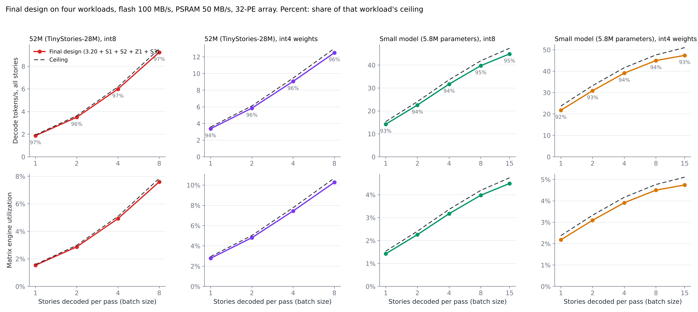

## Phase 6: other workloads on the final design

Each row is the final firmware and hardware (step 3.20 plus the cross-size steps S1, S2, Z1 and S3 below) with the workload changed. The ceiling is the dependency-aware one, computed from that build's own measured link busy cycles. int4 assumes the weight stream unpacks int4 to int8 at no cost; the KV cache stays int8. Max batch is the most stories per pass that fit the 32 KB DTCM (15 for the small model; 8 for 52M). Before S1 and S2 (step 3.20 as is), the small model reached 81 to 82% of its ceiling at batch 1; the cross-size hill climb below raised it to 92 to 93%.

| Workload | Batch | Tokens/s, all stories | Each story | Share of ceiling | Matrix utilization | Flash busy | PSRAM busy |

| --- | ---: | ---: | ---: | ---: | ---: | ---: | ---: |
| 52M (TinyStories-28M), int8 | 1 | 1.87 | 1.87 | 97% | 1.54% | 97% | 9% |
| 52M (TinyStories-28M), int8 | 2 | 3.50 | 1.75 | 96% | 2.88% | 91% | 17% |
| 52M (TinyStories-28M), int8 | 4 | 5.99 | 1.50 | 97% | 4.93% | 78% | 29% |
| 52M (TinyStories-28M), int8 | 8 | 9.24 | 1.16 | 97% | 7.60% | 60% | 44% |
| 52M, int4 weights | 1 | 3.38 | 3.38 | 94% | 2.78% | 89% | 16% |
| 52M, int4 weights | 2 | 5.85 | 2.92 | 96% | 4.81% | 77% | 28% |
| 52M, int4 weights | 4 | 9.06 | 2.27 | 96% | 7.45% | 60% | 43% |
| 52M, int4 weights | 8 | 12.50 | 1.56 | 96% | 10.28% | 41% | 60% |
| Small (5.8M), int8 | 1 | 14.23 | 14.23 | 93% | 1.42% | 84% | 26% |
| Small (5.8M), int8 | 2 | 22.58 | 11.29 | 94% | 2.26% | 67% | 41% |
| Small (5.8M), int8 | 4 | 31.72 | 7.93 | 94% | 3.18% | 47% | 57% |
| Small (5.8M), int8 | 8 | 39.76 | 4.97 | 95% | 3.98% | 29% | 71% |
| Small (5.8M), int8 | 15 | 44.87 | 2.99 | 95% | 4.49% | 18% | 81% |
| Small (5.8M), int4 weights | 1 | 21.78 | 21.78 | 92% | 2.18% | 66% | 39% |
| Small (5.8M), int4 weights | 2 | 30.90 | 15.45 | 93% | 3.09% | 47% | 56% |
| Small (5.8M), int4 weights | 4 | 39.10 | 9.78 | 94% | 3.91% | 30% | 70% |
| Small (5.8M), int4 weights | 8 | 44.98 | 5.62 | 94% | 4.50% | 17% | 81% |
| Small (5.8M), int4 weights | 15 | 47.40 | 3.16 | 93% | 4.74% | 10% | 85% |

Time to first token, 32-token prompt: 52M (TinyStories-28M), int8 1.414 s; 52M, int4 weights 0.790 s; Small (5.8M), int8 0.263 s; Small (5.8M), int4 weights 0.167 s.

Cross-size hill climb (each step written for both sizes, measured on all four workloads, kept if it gains more than 2% on any):

| Step | Change | 52M int8 | 52M int4 | Small int8 | Small int4 | Result |
| --- | --- | --- | --- | --- | --- | --- |
| S1 | Bug fix from step 3.16: mark 64 / head size heads ready per finished qkv group (it marked 2, right only for 52M) | 0.0% | 0.0% | +4.4% b1 | +3.8% b1 | Kept |
| S2 | Layer norm per token (step 3.12), with ITCM room made by removing dead one-token attention code | +1.7% b1 | +3.1% b1 | +5.8% b1, -0.9% b15 | +8.6% b1, -1.0% b15 | Kept |
| S3 | Next linear's weights early (step 3.7 retry) | | | | | Not run: about 270 B more code than the 8 KB ITCM has free |
| S4 | Bias-only DTCM weight buffers, so the small model fits batch 16 | +0.2% | +0.4% | b16 +0.9% over b15 | b16 +0.4% over b15 | Rejected: PSRAM-bound at large batch |
| Z1 | Code-space pass (see below): frees 976 B of ITCM | -0.1% | -0.1% | +0.2% | +0.6% | Adopted as the base: no measurable cost, makes room for S3 |
| S3 | Next linear's weights early, after the code-space pass made room | +1.0% b1 | +1.5% b1 | +2.6% b1 | +0.4% b1, TTFT +1.3% | Kept |
| S5 | Decode attention: twice the KV blocks per transfer, three steps in flight | -0.4% b1, +0.5% b8 | +1.8% b1 | +2.5% b1 | +2.7% b1, +0.4% b15 | Dropped: the KV FIFO would grow from 4.2 to 12.3 KB for 2 to 3% at small b1 |

What limits each workload now: every one is at 90 to 97% of its ceiling. The small model is lowest at batch 1, where fixed costs per pass matter most; from batch 4 up it waits on the PSRAM. After the code-space pass and S3 the 52M prefill image uses 7,496 of 8,192 B of ITCM (696 B free).

PSRAM burst length (a part or mode with longer bursts; config only, `ext_ram_max_burst_bytes`; today 93 B), on step 3.20. Decode tokens/s:

| Workload | Batch | 93 B | 186 B | 372 B | No limit |
| --- | ---: | ---: | ---: | ---: | ---: |
| 52M, int8 | 1 | 1.82 | 1.83 (+0.2%) | 1.83 (+0.3%) | 1.83 (+0.3%) |
| 52M, int8 | 2 | 3.43 | 3.48 (+1.6%) | 3.51 (+2.4%) | 3.54 (+3.1%) |
| 52M, int8 | 4 | 5.91 | 6.10 (+3.2%) | 6.20 (+4.9%) | 6.29 (+6.4%) |
| 52M, int8 | 8 | 9.19 | 9.67 (+5.2%) | 9.94 (+8.1%) | 10.18 (+10.8%) |
| 52M, int4 | 1 | 3.23 | 3.28 (+1.5%) | 3.31 (+2.3%) | 3.32 (+2.7%) |
| 52M, int4 | 2 | 5.67 | 5.83 (+2.9%) | 5.92 (+4.5%) | 6.00 (+5.9%) |
| 52M, int4 | 4 | 8.89 | 9.33 (+5.0%) | 9.58 (+7.8%) | 9.81 (+10.3%) |
| 52M, int4 | 8 | 12.41 | 13.30 (+7.2%) | 13.81 (+11.3%) | 14.28 (+15.1%) |

## Code space (ITCM) pass

The 8 KB ITCM must hold the prefill and decode code in one image. The build already optimized for size and dropped unused functions. Two more changes free 976 B in the 52M prefill image (8,184 to 7,208 B): `-msave-restore` (shared function entry and exit code, -440 B) and dma() as one function instead of inlined at every call (-388 B). Measured on all four workloads (step Z1): -0.1% to +0.6%, so no measurable cost. Used as the base for experiments A and B and step S3.

## Experiment A: low-rank weights, computed as (x U) V

Each weight matrix W [in x out] is stored as two factors U [in x r] and V [r x out], about half the bytes (r = 128 / 192 / 256 at 52M, 64 / 128 / 128 in the small model), and each linear runs as two smaller linears. Firmware only; no new hardware beyond the kept design. **Accuracy is not known**: the simulator does not compute values, and a rank-r factorization of trained weights needs an offline check or retraining.

| Workload | Batch | Tokens/s | vs int8 | vs int4 weights | Flash cycles per pass | MACs vs int8 |
| --- | ---: | ---: | ---: | ---: | ---: | ---: |
| 52M | 1 | 3.33 | +80% | -0% | 12.87 M (int8 25.89 M) | 0.51 x |
| 52M | 2 | 5.74 | +65% | -1% | 12.87 M (int8 25.89 M) | 0.51 x |
| 52M | 4 | 8.93 | +49% | -1% | 12.87 M (int8 25.89 M) | 0.51 x |
| 52M | 8 | 12.35 | +34% | -1% | 12.87 M (int8 25.90 M) | 0.51 x |
| Small | 1 | 18.99 | +37% | -12% | 1.72 M (int8 2.95 M) | 0.62 x |
| Small | 2 | 27.79 | +23% | -10% | 1.72 M (int8 2.95 M) | 0.62 x |
| Small | 4 | 36.28 | +15% | -7% | 1.72 M (int8 2.95 M) | 0.62 x |
| Small | 8 | 42.76 | +8% | -5% | 1.72 M (int8 2.96 M) | 0.62 x |
| Small | 15 | 46.21 | +3% | -2% | 1.73 M (int8 2.96 M) | 0.62 x |

Time to first token: 52M 0.765 s (int8 1.420 s); small 0.194 s (int8 0.262 s).

At 52M, A runs at the speed of int4 weights (same bytes): the second linear per matrix costs almost nothing. In the small model the ranks, rounded to multiples of 64, keep 58% of the bytes, so it is 2 to 12% below int4.

### Experiment A on the original one-DMA design (no assumed hardware)

The same low-rank weights on step 3.3: Joshua's firmware with real multi-story decode, the upstream core (16-entry ROB, newer LSU), one DMA channel with its original wait-for-everything register, weights through the DTCM. 52M model, int8 factors. x U goes into a DTCM buffer that is idle at that point (the KV staging buffer, or the layer norm output).

| Batch | Step 3.3, int8 | A on the same design | Change | Flash cycles per pass | PSRAM cycles per pass |
| ---: | ---: | ---: | ---: | ---: | ---: |
| 1 | 1.56 | 2.71 | +74% | 26.09 M to 12.95 M | 2.42 M (unchanged) |
| 2 | 2.88 | 4.73 | +64% | 26.09 M to 12.95 M | 4.84 M (unchanged) |
| 4 | 4.99 | 7.54 | +51% | 26.09 M to 12.95 M | 9.67 M (unchanged) |
| 8 | 7.86 | 10.71 | +36% | 26.10 M to 12.96 M | 19.35 M (unchanged) |

Time to first token: 1.598 s to 0.923 s. The saving does not depend on the assumed hardware: the flash time halves on either design. The gain is smaller at large batch here because the flash and the PSRAM take turns, so only the flash half of each pass shrinks. On the final design A reaches 3.33 tokens/s at batch 1 (against 2.71 here).

### Experiment A and A + int4 on the final design

Same low-rank weights on the final design (S3's next-linear prefetch is off for A), with int8 and with int4 factors. Tokens/s, all stories; the change is against the same design and precision without A.

| Workload | Batch | Without A | With A | Change |
| --- | ---: | ---: | ---: | ---: |
| 52M int8 | 1 | 1.87 | 3.35 | +79% |
| 52M int8 | 8 | 9.24 | 12.33 | +33% |
| 52M int4 | 1 | 3.38 | 5.49 | +63% |
| 52M int4 | 8 | 12.50 | 14.84 | +19% |
| Small int8 | 1 | 14.23 | 18.90 | +33% |
| Small int8 | 8 | 39.76 | 42.82 | +8% |
| Small int8 | 15 | 44.87 | 46.16 | +3% |
| Small int4 | 1 | 21.78 | 26.29 | +21% |
| Small int4 | 8 | 44.98 | 46.02 | +2% |
| Small int4 | 15 | 47.40 | 47.30 | -0% |

A + int4 against plain int8 (52M): 2.9 x at batch 1, 1.6 x at batch 8. Not 4 x: the flash bytes drop to a quarter, but the PSRAM time per story and the fixed costs per pass do not. Time to first token, 52M: 1.41 s (int8), 0.76 s (A), 0.49 s (A + int4).

## Experiment B: rebuild each 16x16 weight tile on the matrix engine

Each 16x16 tile is stored as rank-4 factors (16x4 and 4x16, half the bytes). For every tile the matrix engine multiplies the factors into a spare accumulator; the core reads the 16 rows out, narrows them to int8 and stores them as a normal weight chunk; then the normal MACs use it. **Accuracy is not known** (as for A).

| Workload | Batch | Tokens/s | vs int8 | vs int4 weights | Flash cycles per pass | MACs vs int8 |
| --- | ---: | ---: | ---: | ---: | ---: | ---: |
| 52M | 1 | 0.52 | -72% | -85% | 13.86 M (int8 25.89 M) | 4.87 x |
| 52M | 2 | 1.01 | -71% | -83% | 13.86 M (int8 25.89 M) | 2.94 x |
| 52M | 4 | 1.96 | -67% | -78% | 13.86 M (int8 25.89 M) | 1.97 x |
| 52M | 8 | 3.61 | -61% | -71% | 13.86 M (int8 25.90 M) | 1.48 x |
| Small | 1 | 4.30 | -69% | -80% | 1.59 M (int8 2.95 M) | 4.60 x |
| Small | 2 | 8.08 | -64% | -74% | 1.59 M (int8 2.95 M) | 2.80 x |
| Small | 4 | 14.39 | -55% | -63% | 1.59 M (int8 2.95 M) | 1.90 x |
| Small | 8 | 22.77 | -43% | -49% | 1.59 M (int8 2.96 M) | 1.45 x |
| Small | 15 | 30.32 | -32% | -36% | 1.60 M (int8 2.96 M) | 1.24 x |

Time to first token: 52M 4.968 s (int8 1.420 s); small 0.839 s (int8 0.262 s).

B is 32 to 72% slower than int8. The array is idle (2 to 7% busy) and the flash too (13 to 14%): the core spends the pass reading rebuilt tiles out of the accumulator (16 reads per tile, about 100 instructions per tile, about 200 K tiles per token at 52M); dispatch waits on a full vector queue 45% of the time. It would need a hardware path that feeds a rebuilt tile straight back in as the weight operand, which Coral's matrix engine does not have.

