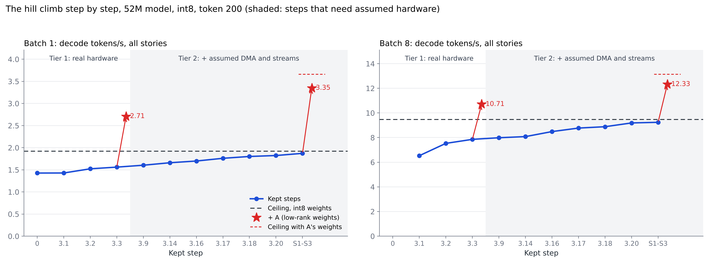

## The hill climb in one table

52M model (TinyStories-28M), int8, decode of token 200, flash 100 MB/s, PSRAM 50 MB/s. Tokens/s, all stories. Each kept step adds to the one before. **Tier 1** uses only real hardware: the M3 core with two upstream Coral core changes, and the basic one-channel DMA that the firmware already assumes. **Tier 2** adds assumed hardware (not in the RTL): per-transfer DMA waits, a second DMA channel, and weight and KV streams into the matrix engine (about 12.5 KB of FIFOs). Experiment A (low-rank weights, a firmware and weight-format change, accuracy not checked) is shown on top of each tier.

| Tier | Step | Change | What it is | Batch 1 | Batch 8 |
| --- | --- | --- | --- | ---: | ---: |
| 1 | 0 | Baseline: M3 core, Joshua's firmware | Starting point | 1.43 | n/a |
| 1 | 3.1 | Real multi-story decode | Firmware: one weight pass serves up to 8 stories | 1.43 | 6.53 |
| 1 | 3.2 | 16-entry reorder buffer | Upstream Coral core | 1.52 | 7.53 |
| 1 | 3.3 | Newer load/store unit | Upstream Coral core | 1.56 | 7.86 |
| 1 | + A | Low-rank weights on tier 1 | Firmware and weight format | **2.71** | **10.71** |
| 2 | 3.9 | Per-transfer DMA wait | Assumed DMA feature: start the next weight transfer before waiting | 1.60 | 7.99 |
| 2 | 3.14 | Epilogue one row per token | Firmware | 1.66 | 8.08 |
| 2 | 3.16 | Attention during the qkv weights | Assumed: second DMA channel; firmware reorders qkv by head pair | 1.70 | 8.49 |
| 2 | 3.17 | Weight stream into the matrix engine | Assumed: FIFO in the engine, MACs read weights from it | 1.76 | 8.77 |
| 2 | 3.18 | 4 KB stream transfers | Assumed: 8.3 KB weight FIFO | 1.80 | 8.88 |
| 2 | 3.20 | KV stream into the matrix engine | Assumed: 4.2 KB KV FIFO | 1.82 | 9.19 |
| 2 | S1-S3 | Cross-size firmware steps S1, S2, S3 | Firmware: head-ready fix, layer norm per token, next weights early (with the code-space pass) | 1.87 | 9.24 |
| 2 | + A | Low-rank weights on tier 2 | Firmware and weight format | **3.33** | **12.35** |
| | | Ceiling, int8 weights (from the link times) | | 1.92 | 9.46 |
| | | Ceiling with A's weights (half the flash bytes) | | 3.66 | 13.14 |

The tier-2 firmware steps (3.14, S1 to S3) were measured on tier 2 only; some would also help tier 1, so tier 1 is a conservative figure. The ceiling is for int8 weights; A and int4 lower the bytes and so raise their own ceiling.

### What each kept step changed

| Step | Kind | What changed |
| --- | --- | --- |
| 3.1 | Firmware | One weight pass serves up to 8 stories: each story gets its own KV cache, position, attention call and next-token pick |
| 3.2 | Core (upstream Coral) | Reorder buffer 8 to 16 entries |
| 3.3 | Core (upstream Coral) | Newer load/store unit: overhead per instruction instead of per vector register |
| 3.9 | Assumed DMA + firmware | The DMA numbers its transfers and can wait for all but the newest, so the next weight chunk starts before the current one is waited for |
| 3.14 | Firmware | Linear epilogue reads one accumulator row per token (16 features) instead of one column per feature |
| 3.16 | Assumed DMA + firmware | A second DMA channel (flash and PSRAM at the same time) and a wait for one numbered transfer; qkv computed one head pair at a time so attention runs between qkv weight chunks |
| 3.17 | Assumed hardware + firmware | Weights go from the DMA into a FIFO in the matrix engine; MACs take their weight operand from it, so the MAC loop loads only activations |
| 3.18 | Assumed hardware | 4 KB stream transfers instead of 2 KB (weight FIFO 8.3 KB) |
| 3.20 | Assumed hardware + firmware | KV cache streamed into the matrix engine the same way (KV FIFO 4.2 KB) |
| S1 | Firmware (bug fix) | Attention starts each head as soon as its q, k, v exist, for any head size (was right only for the 52M model) |
| S2 | Firmware | Layer norm per token, 16 features per vector (made room in ITCM by removing dead one-token attention code) |
| Z1 | Build | Code-size pass: shared function entry/exit code, DMA helper not inlined (frees 976 B of ITCM, no speed change) |
| S3 | Firmware | The next linear's first weight chunks start during the current linear's last ones |

### Firmware changes by kernel (Joshua's firmware, 83f7152, to the final design)

| Kernel | Used for | Changes |
| --- | --- | --- |
| `main.cc` | The decode loop | Multi-story decode (3.1); qkv by head pair with attention in between, attention output written over q (3.16); next-linear hints (S3) |
| `linear.cc` | qkv, attn_out, fc1, fc2, lm_head | Argmax per story (3.1); next chunk before the wait (3.9); epilogue by row (3.14); waits for its own transfer, column-group ranges, attention hook (3.16); MAC loop without weight loads, bias by DMA (3.17); 4 KB chunks (3.18); next linear's chunks early (S3); DMA helper as one function (Z1) |
| `attention.cc` | Attention | Per-story KV cache (3.1); step-wise decode attention paced between weight chunks, 176 B decode state (3.16); KV MACs from the stream, new-token block through the DTCM (3.20); head-ready count (S1); dead one-token code removed (S2) |
| `layernorm.cc` | ln1, ln2, ln_f | Per token, 16 features per vector (S2) |
| `lm_head.cc`, `embed.cc` | Output, input | Next-token pick per story, all stories at one position (3.1) |
| `npu.hpp`, `common.hpp` | Helpers, DTCM layout | Numbered DMA transfers and waits (3.9, 3.16); stream MAC loops (3.17, 3.20); decode attention state in the DTCM (3.16) |

Rejected and dropped steps (3.4 to 3.8, 3.10 to 3.13, 3.15, 3.19, S4, S5) are in the full table below and in LOG.md.

